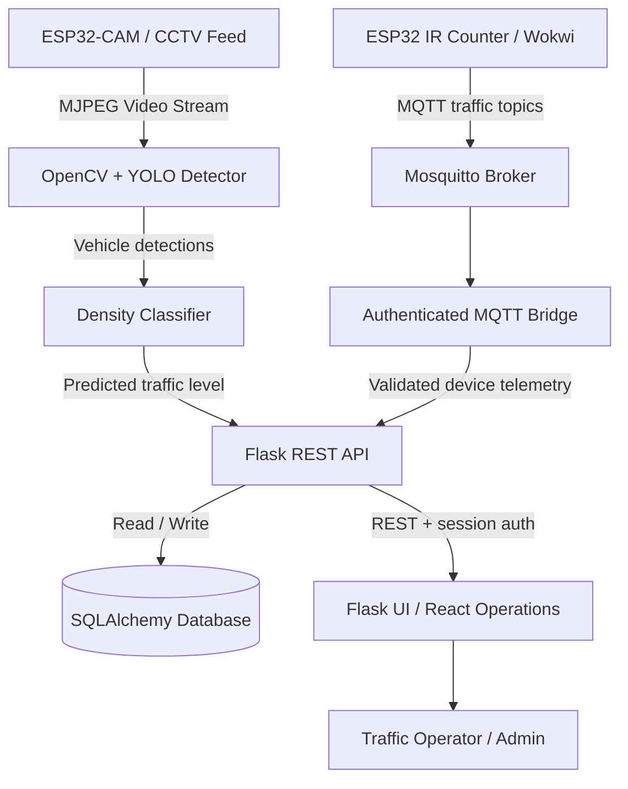
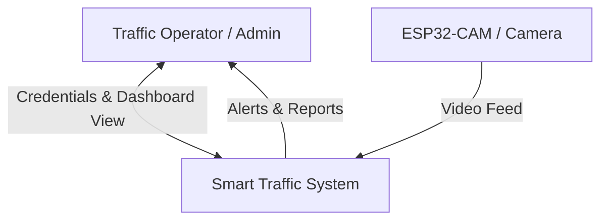
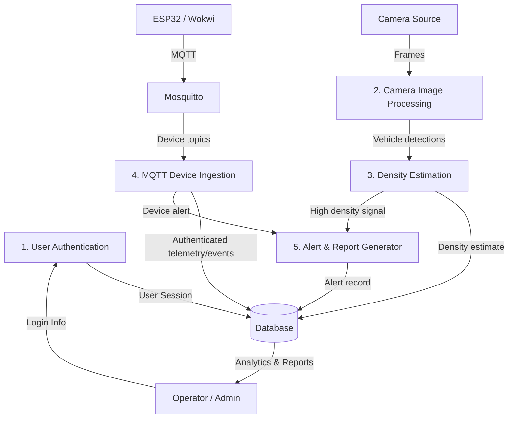
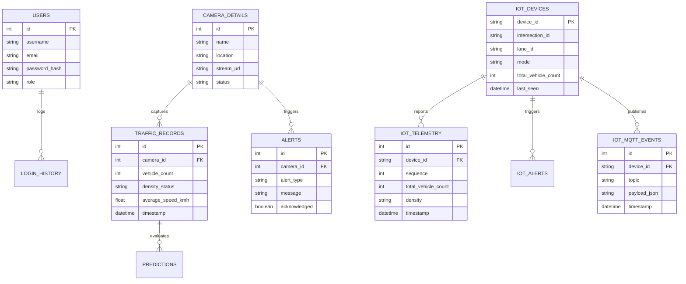
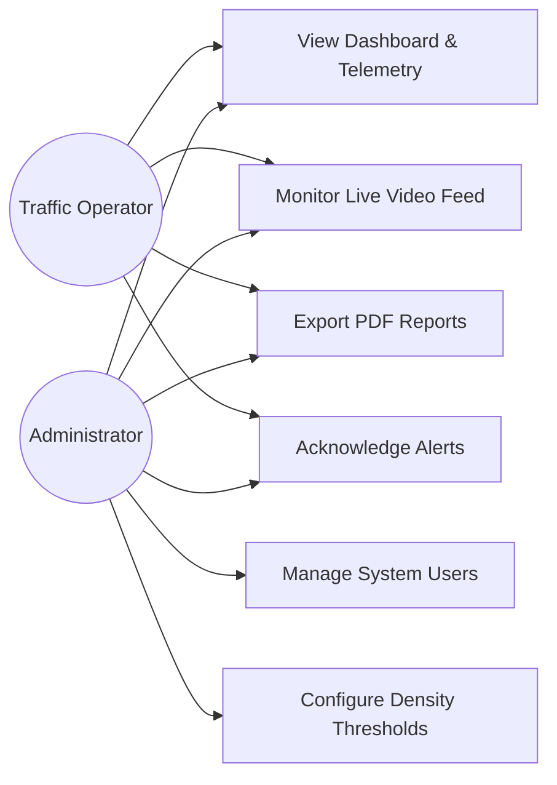
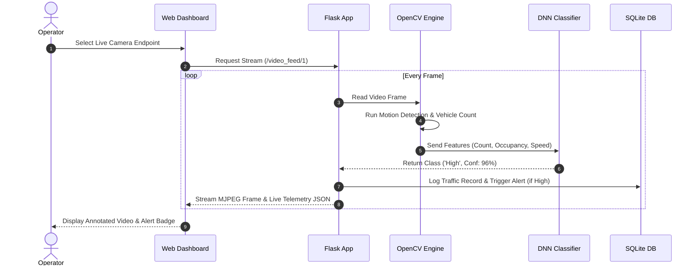
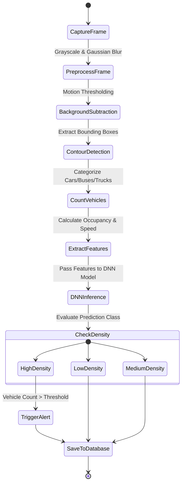

# UML Diagrams & Data Flow Diagrams (DFD)

## 1. System Architecture Diagram

---

## 2. Data Flow Diagram (DFD)

### DFD Level 0 (Context Diagram)

### DFD Level 1

---

## 3. Entity-Relationship (ER) Diagram

---

## 4. Use Case Diagram

---

## 5. Sequence Diagram (Live Monitor & DNN Inference)

---

## 6. Activity Diagram (Traffic Density Classification Flow)

